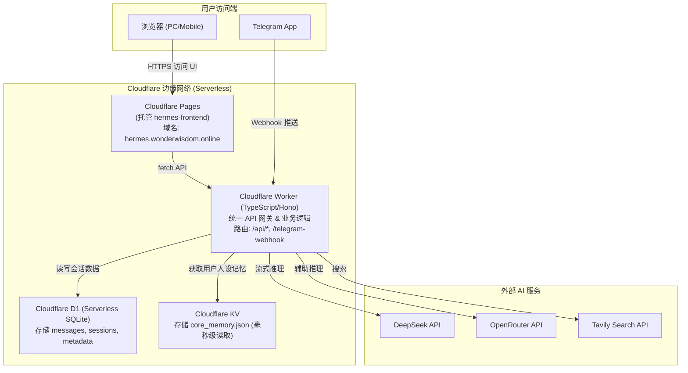

# 🚀 Hermes Agent 迁移至 Cloudflare (CF) Native 实施方案与交接文档

> **文档目的**：本文件为 Hermes 智能体对话系统从阿里云服务器彻底迁移至 **Cloudflare (CF) 全栈 Serverless 架构** 的系统设计、实施蓝图与 Codex 编程接力指令。  
> **归档时间**：2026-11-10  
> **数据备份源**：`/Users/derek/Projects/aliyun_cloud_backup_20261110/hermes-agent/`

---

## 📌 目录
1. [系统背景与资产盘点](#1-系统背景与资产盘点)
2. [Cloudflare Native 目标架构设计](#2-cloudflare-native-目标架构设计)
3. [方案 C 的核心劣势与应对策略](#3-方案-c-的核心劣势与应对策略)
4. [Cloudflare 费用与免费额度测算](#4-cloudflare-费用与免费额度测算)
5. [数据库与记忆迁移规范 (SQLite -> CF D1)](#5-数据库与记忆迁移规范-sqlite---cf-d1)
6. [分步实施路线图 (Codex 执行指引)](#6-分步实施路线图-codex-执行指引)

---

## 1. 系统背景与资产盘点

### 1.1 什么是 Hermes？
Hermes 是专为 Derek（CFA持证人/跨境财富管理/视频号博主）定制的个人 AI 助理（代号“迪哥”）。它具备：
- **Web 对话界面**：支持密码认证、流式输出、会话切换与管理；
- **长期记忆 (Core Memory)**：固化了 Derek 的职业背景、小红书策略、视频号文案风格库、禁忌红线；
- **情景记忆 (Episodic Memory)**：通过 SQLite FTS5 全文索引历史会话；
- **多模型驱动**：调用 DeepSeek / OpenRouter / Tavily 联网搜索；
- **Telegram 机器人**：随时在手机 Telegram 里收发对话。

### 1.2 本地已备份的关键文件
本地备份路径：`/Users/derek/Projects/aliyun_cloud_backup_20261110/hermes-agent/`
- `hermes_data/memory/conversations.db`（1.2 MB，包含历史会话表 `messages`、`episodic_memory`、`session_metadata`、`delegated_tasks`）
- `hermes_data/memory/core_memory.json`（核心记忆与文案库）
- `hermes_data/skills/derek_script_style.py`（文案风格约束）
- `hermes-frontend/`（前端静态文件：`index.html`、`script.js`、`style.css`）
- `hermes-agent/.env`（内含 API KEY：OpenRouter、DeepSeek、Tavily、Telegram Bot Token、WebUI 密码）

---

## 2. Cloudflare Native 目标架构设计



---

## 3. 方案 C 的核心劣势与应对策略

选择全栈 Cloudflare Native 虽然实现了 **0 服务器运维、0 闲置费用**，但必须正视以下劣势及解决方案：

### 劣势 1：Python 到 TypeScript 的代码重构成本
- **现状**：原有逻辑由 Python FastAPI 编写。
- **应对**：使用轻量极致的 **Hono.js** 框架在 Cloudflare Worker 上运行。Hono 与 FastAPI 的路由风格高度相似，开发体验流畅，几十行即可搭建完 `/api/chat`、`/api/sessions`、`/api/history` 等端点。

### 劣势 2：重型文档解析库缺失 (PyMuPDF / Pandas / OpenPyXL)
- **现状**：原系统在 Python 下可解析 PDF、Word、Excel 并注入 Prompt。Cloudflare V8 隔离环境无法运行 C 扩展库。
- **应对**：
  1. **第一阶段**：优先使用轻量 JS 文本提取库（如 `unpdf` 处理普通文本型 PDF；`xlsx` 解析小型表格）；
  2. **第二阶段**：直接利用现代多模态 LLM（如 Gemini Flash / Claude 3.5 Sonnet）的直接文档识别能力，将 PDF Base64 传递给大模型，避免在 Worker 内进行重型本地解析。

### 劣势 3：Telegram Bot 必须由“长轮询 (Polling)”改为“Webhook”
- **现状**：旧版后台常驻一个线程不断轮询拉取 Telegram 消息，Serverless 环境无常驻线程。
- **应对**：向 Telegram 官方注册 Webhook URL（如 `https://hermes.wonderwisdom.online/api/telegram-webhook`）。Telegram 收到消息后直接 HTTP POST 推送到 Worker，响应更快，且不消耗任何空转资源。

### 劣势 4：执行时间限制 (Wall-clock Timeout)
- **现状**：复杂的 Agent Team 思考可能耗时 60~90 秒。
- **应对**：
  - WebUI 对话开启 **SSE (Server-Sent Events) 流式传输**。在 CF Worker 中，流式向客户端 pump 数据是不受 10ms CPU 限制约束的，只要网络连接不断即可；
  - 超长推理可在 Worker 中使用 `ctx.waitUntil()` 处理后台落库。

---

## 4. Cloudflare 费用与免费额度测算

> [!IMPORTANT]
> **结论：Hermes 作为一个供个人及小团队使用的系统，迁移至 Cloudflare 后的月度云服务账单为 0 元（完全由免费额度覆盖）。**

| 服务项目 | Cloudflare 免费版额度 | Hermes 预计日常消耗 | 是否产生费用？ |
| :--- | :--- | :--- | :--- |
| **Cloudflare Pages** (前端) | 无限请求量、无限流量、免费 SSL、自定义域名 | 每月几千次静态页面请求 | **¥0 (完全免费)** |
| **Cloudflare Workers** (API) | **每天 100,000 次请求** | 每天 50 ~ 300 次对话请求 (使用量 < 0.3%) | **¥0 (完全免费)** |
| **Cloudflare D1** (数据库) | **存储 5 GB**<br>每天 500 万次读取 / 10 万次写入 | 存储约 2 MB<br>每天约 500 次读写 | **¥0 (完全免费)** |
| **Cloudflare KV** (人设记忆) | **存储 1 GB**，每天 10 万次读取 | 存储约 10 KB，每天几百次读取 | **¥0 (完全免费)** |
| **外网 API 调用** (DeepSeek/OpenRouter) | 依个人 API 充值按 Token 计费 | 与之前一致，不随平台改变 | 正常 API 消耗 |

---

## 5. 数据库与记忆迁移规范 (SQLite -> CF D1)

### 5.1 CF D1 目标表结构 (Schema)
在 Cloudflare D1 执行以下建表语句：

```sql
-- 1. 会话消息表
CREATE TABLE IF NOT EXISTS messages (
    id INTEGER PRIMARY KEY AUTOINCREMENT,
    session_id TEXT NOT NULL,
    role TEXT NOT NULL,
    content TEXT NOT NULL,
    timestamp DATETIME DEFAULT CURRENT_TIMESTAMP
);
CREATE INDEX IF NOT EXISTS idx_session_id ON messages(session_id);

-- 2. 会话元数据表
CREATE TABLE IF NOT EXISTS session_metadata (
    session_id TEXT PRIMARY KEY,
    title TEXT,
    updated_at DATETIME DEFAULT CURRENT_TIMESTAMP
);

-- 3. 委派任务表 (保留未来扩展)
CREATE TABLE IF NOT EXISTS delegated_tasks (
    id TEXT PRIMARY KEY,
    session_id TEXT NOT NULL,
    status TEXT NOT NULL DEFAULT 'pending',
    priority TEXT DEFAULT 'normal',
    title TEXT,
    prompt TEXT NOT NULL,
    context_json TEXT,
    result TEXT,
    source_channel TEXT DEFAULT 'unknown',
    created_at DATETIME DEFAULT CURRENT_TIMESTAMP,
    completed_at DATETIME
);
CREATE INDEX IF NOT EXISTS idx_delegated_status ON delegated_tasks(status);
```

### 5.2 数据导出与导入脚本
在本地备份目录中提取 SQL 并导入 D1：
```bash
# 1. 从原备份 sqlite 导出数据 INSERT 语句 (排除 fts5 虚拟表)
sqlite3 /Users/derek/Projects/aliyun_cloud_backup_20261110/hermes-agent/hermes_data/memory/conversations.db \
  ".dump messages session_metadata delegated_tasks" > hermes_d1_seed.sql

# 2. 通过 Wrangler 导入到远端 Cloudflare D1
npx wrangler d1 execute hermes-db --remote --file=hermes_d1_seed.sql
```

### 5.3 核心人设记忆 (Core Memory)
将 `core_memory.json` 写入 Cloudflare KV 命名空间 `HERMES_KV`，键名为 `core_memory`。Worker 在初始化 Prompt 时注入其中的文案风格、选题策略与红线规则。

---

## 6. 分步实施路线图 (Codex 执行指引)

当将此任务交给 **Codex** 继续执行时，可直接向 Codex 发送以下指令链：

### 第一步：初始化 Worker 项目
```bash
# 在 /Users/derek/Projects 下创建新项目
npm create cloudflare@latest hermes-cloudflare -- --framework=hono --lang=ts
cd hermes-cloudflare

# 创建 D1 数据库与 KV
npx wrangler d1 create hermes-db
npx wrangler kv namespace create HERMES_KV
```

### 第二步：编写 Worker API 端点 (TypeScript)
在 `src/index.ts` 中实现以下标准接口：
1. `GET /api/health`：健康检查；
2. `POST /api/chat`：接收 `{ message, session_id, model }`，从 KV 获取人设，从 D1 获取历史上下文，调用 DeepSeek/OpenRouter，使用 Server-Sent Events (SSE) 流式返回并将对话回写 D1；
3. `GET /api/sessions`：查询会话列表；
4. `GET /api/history?session_id=...`：查询单会话历史消息；
5. `POST /api/telegram-webhook`：接收 Telegram 消息，生成回复并使用 `sendMessage` API 发送回用户。

### 第三步：部署前端到 Cloudflare Pages
1. 将本地 `/Users/derek/Projects/aliyun_cloud_backup_20261110/hermes-frontend/` 下的 `index.html`、`script.js`、`style.css` 整理至 `public/` 目录；
2. 调整 `script.js` 中的 API 请求地址为相对路径 `/api/...`；
3. 使用 `npx wrangler pages deploy public --project-name=hermes-web` 部署；
4. 在 Cloudflare 控制台将域名 `hermes.wonderwisdom.online` 绑定至该 Pages 项目。

### 第四步：设置 Telegram Webhook
```bash
curl -F "url=https://hermes.wonderwisdom.online/api/telegram-webhook" \
  https://api.telegram.org/bot<TELEGRAM_BOT_TOKEN>/setWebhook
```
